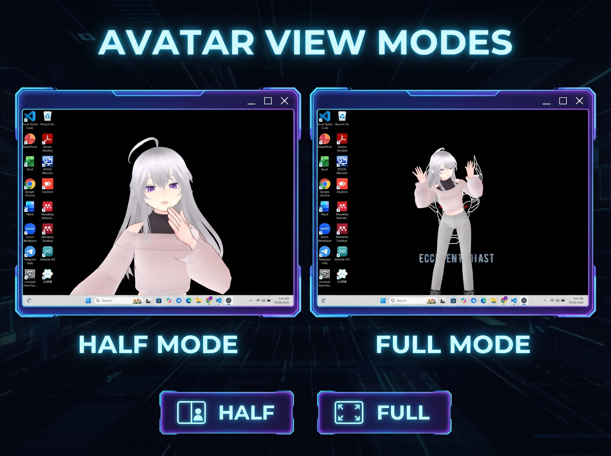
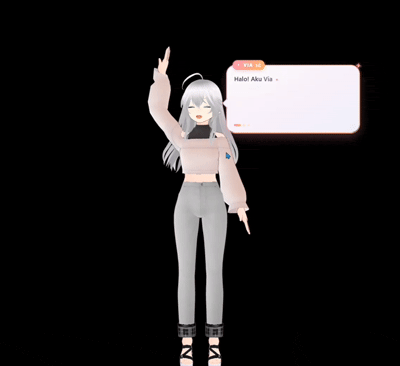

# Virtual Interactive Assistant 3D (VIA-3D)

A desktop VRM avatar assistant that listens to your voice, replies through
the Google Gemini API, and reflects emotion through facial expressions and
body gestures — all rendered in real time with Three.js inside an Electron
window.

The app runs as a **transparent, frameless window** that can sit on top of
your desktop. There are no on-screen buttons — everything is controlled by
keyboard.



*The avatar window in action.*



*Live demo: voice reply, lipsync, and body gestures.*
---

## Features

- **Voice conversation** — press `R` to record, speak, and the app sends
  the audio to Gemini for speech-to-text, response generation, and
  text-to-speech playback.
- **Real-time lipsync** — mouth movement is driven by the live volume of
  the AI's audio reply, analyzed via the Web Audio API.
- **Emotion-driven expressions** — the LLM tags each reply with an emotion,
  which the app translates into a VRM facial expression preset (happy,
  sad, angry, etc.).
- **Semantic gestures** — the LLM can trigger body animations by meaning
  (e.g. `[gesture:pengenalan]`), mapped to `.vrma` files through a central
  registry. Adding a new gesture requires editing only one place.
- **Tool calling & agent skills** — the LLM can invoke local tools via
  inline tags like `[tool:open_browser|https://google.com]`, and in
  v0.3.0 the agent can also plan multi-step tasks. Available tools:
  - **Core tools:** `open_browser`, `screenshot`, `view_screenshot`,
    `find_files`, `read_pdf`, `pdf_pick_and_read`
  - **File & workspace:** `read_excel`, `create_excel`, `project_list`,
    `project_read_file`, `project_write_file`, `project_edit_file`,
    `project_propose_plan`, `apply_patch`
  - **Agent loop:** `reason` (internal reasoning step)
- **Agent skills** *(new in v0.3.0)* — the assistant can read PDF and
  Excel files, and perform "vibe coding" by proposing and applying code
  patches to your workspace through a plan-and-confirm loop.

---

## Requirements

- **Node.js** 18+ (`node -v` to check)
- **A VRM avatar file** (`.vrm`) — see [assets/README.md](assets/README.md)
- **`.vrma` animation files** — same README
- **A Google Gemini API key** — https://aistudio.google.com/app/apikey

---

## Setup

### 1. Install dependencies

```bash
npm install
```

### 2. Configure your Gemini API key

Copy `.env.example` to `.env` and fill in your key:

```bash
cp .env.example .env
```

Then edit `.env`:

```
GEMINI_API_KEY=your_key_here
```

The `.env` file is git-ignored and never leaves your machine.

### 3. Provide the avatar and animation assets

See [assets/README.md](assets/README.md) for exact filenames and
placement. The app expects:

```
assets/
├── avatar.vrm
├── poses/
│    ├── bow.vrma
│    ├── nod.vrma
│    ├── greeting.vrma
│    └── ... (see src/avatar/poses.json for the full list)
├── idle-full.vrma
├── idle-half.vrma
├── gesture-1.vrma
├── gesture-2.vrma
├── gesture-3.vrma
└── gesture-4.vrma
```

### 4. Run the app

```bash
npm start
```

A transparent window will appear with your avatar. DevTools opens
automatically for console logs — useful for debugging.

---

## Controls

| Key | Action |
|---|---|
| `R` | Start / stop recording (toggle) |
| `M` | Switch camera mode (full body ↔ half body) |
| `1` / `2` / `3` | Manually play gesture 1 / 2 / 3 |
| `+` / `=` | Enlarge window |
| `-` / `_` | Shrink window |
| `Esc` | Quit application |
| `Y` / `N` | Confirm / reject the agent's proposed plan |

The window is draggable — click and hold on any empty area (not on a
button) to move it around your desktop.

---

## Troubleshooting

### Avatar doesn't appear

- Check DevTools console for errors from `src/avatar/vrm.js`.
- The most common cause: the file isn't at `assets/avatar.vrm` or isn't
  named exactly that.
- If the screen is black, the camera might be positioned too far or too
  close — adjust `CAMERA_CONFIGS` in `src/core/cameraRig.js`.

### Avatar faces away from the camera

This project calls `VRMUtils.rotateVRM0()` in `src/avatar/vrm.js`, which
is only needed for **VRM 0.x** models (they face −Z by default). If you
use a **VRM 1.0** model, comment out that line or the avatar will face
the wrong way.

### "GEMINI_API_KEY tidak ditemukan" on startup

- Make sure `.env` exists in the **same folder as `package.json`**.
- Make sure it contains a valid line: `GEMINI_API_KEY=...`
- Restart the app after editing `.env` — it's read only at startup.

### Mic indicator stays on after recording

- The app stops the mic track as soon as recording ends. If the OS
  indicator stays on, close the app and reopen — this is usually an OS
  caching issue, not a bug in the app.

### Voice reply plays but mouth doesn't move

- Lipsync only runs in **half-body mode** by default (the face is too
  small in full-body mode). Press `M` to switch.
- Check that `speechConfig` in `main.js` is producing audio output —
  if the TTS response is empty, there's nothing to analyze.

---

## License

- **Source code:** [Apache License 2.0](LICENSE)
- **Third-party assets and services:** see
  [docs/assets-and-credits.md](docs/assets-and-credits.md)

This repository does **not** bundle the VRM avatar or `.vrma` animation
files. You must supply your own — see [assets/README.md](assets/README.md).

---

## Credits

- Voice, response, and speech synthesis powered by
  [Google Gemini API](https://ai.google.dev/).
- **Speech-to-Text and Text-to-Speech services powered by [ElevenLabs](https://elevenlabs.io/).**
- Avatar rendering via [Three.js](https://threejs.org/) and
  [`@pixiv/three-vrm`](https://github.com/pixiv/three-vrm).
- Animation files sourced from the
  [VRoid Project on BOOTH](https://booth.pm/en/items/5512385) — see
  [docs/assets-and-credits.md](docs/assets-and-credits.md) for the required
  credit line if you use them commercially.
